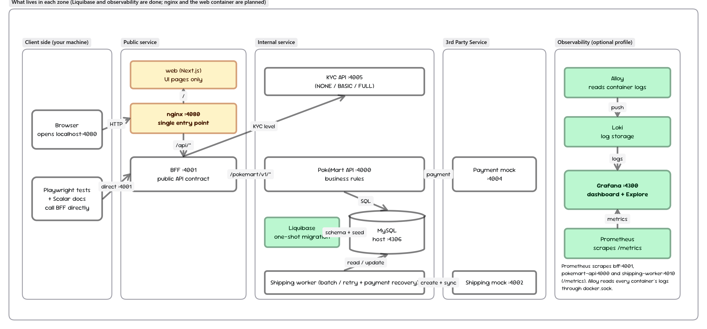
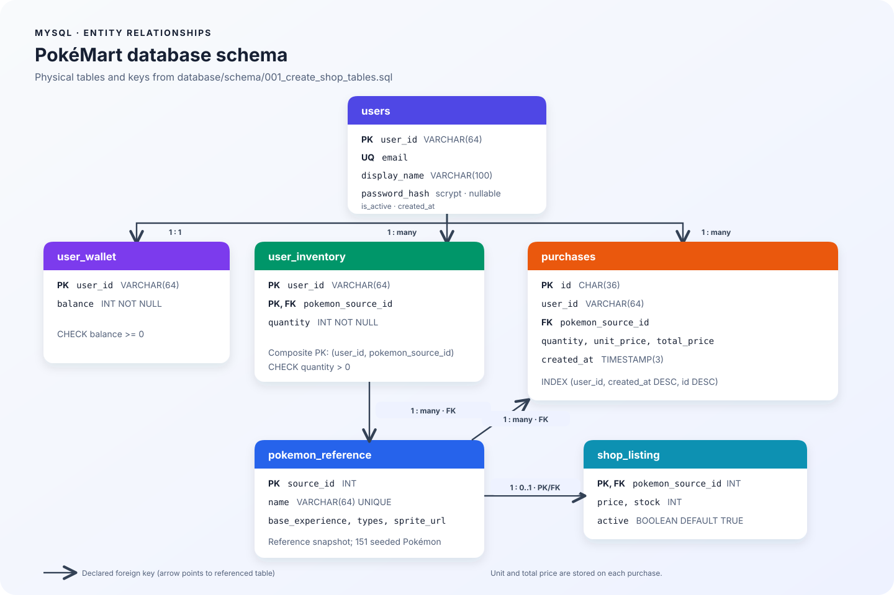

# PokéMart API Automation Lab

โปรเจ็กต์ฝึก API และ UI testing ด้วย Playwright + TypeScript บนร้านค้า PokéMart จำลอง: เว็บ Next.js, public BFF, internal API, MySQL, KYC, payment และ shipping mock ข้อมูล Pokémon/item เป็น snapshot ในฐานข้อมูล จึงเริ่มระบบและทดสอบซ้ำได้โดยไม่ต้องเรียก PokéAPI

## สถาปัตยกรรม



| Service | URL (local) | หน้าที่ |
|---|---|---|
| Web | `http://localhost:4003` | Next.js: catalog (`/`), bag/checkout, wallet, ประวัติคำสั่งซื้อและสถานะจัดส่ง (`/orders`) รันแยกด้วย `npm run dev` |
| BFF | `http://localhost:4001` | Public API ที่ client เรียก แปลง response เป็น public DTO |
| PokéMart API | `http://localhost:4000` | Internal API: business rules และข้อมูล |
| KYC API | `http://localhost:4005` | ตรวจ KYC level 0/1/2 ก่อนขายสินค้า มี test-only routes |
| Payment Mock | `http://localhost:4004` | Stripe-style PaymentIntent สำหรับ wallet top-up |
| Shipping Mock | `http://localhost:4002` | จำลอง shipping provider ภายนอก |
| Shipping Worker | container | อ่านคิว `shipments` (ทั้ง Pokémon และ item) ยิง provider และ sync delivery status |
| WireMock | `http://localhost:8080` | จำลอง public API สำหรับ contract tests |
| Scalar | `http://localhost:8081` | เปิดดู OpenAPI ของทุก service |
| Grafana (ทางเลือก) | `http://localhost:4300` | `make observe`: metric, log และค้น request ID ข้าม BFF → API |
| MySQL | `localhost:4306` | catalog, wallet, inventory, purchases, shipments |

ทั้ง Pokémon และ item ที่ซื้อจะถูกจัดส่ง: ทุกคำสั่งซื้อมี shipment และแสดงสถานะ/tracking number ในหน้า Orders

## เริ่มต้นใช้งาน

**ต้องมี:** Node.js 22, Podman + `podman machine` + podman-compose (`python -m pip install --user podman-compose`) และ GNU Make

หมายเหตุสำหรับ Windows:

- ตั้ง user environment variable `PODMAN_COMPOSE_PROVIDER` เป็น path ของ `podman-compose.exe` (เช่น `C:\Users\<ชื่อ>\AppData\Roaming\Python\Python310\Scripts\podman-compose.exe`) แล้วเปิด terminal ใหม่ ถ้าไม่ตั้ง `podman compose` จะไปเรียก Docker Desktop
- เรียก `make` จาก **PowerShell** ไม่ใช่ Git Bash (Git Bash ทำให้ `podman` หา config ไม่เจอ)
- ใช้ `make up` แทน `podman compose up --build` เพราะ build image ด้วย `podman build` ก่อน

```text
podman machine start
copy .env.example .env      # macOS/Linux: cp .env.example .env  (MYSQL_HOST_PORT=4306 ต้องตรงกับ tests/configs/.env.test)
npm ci
npm run build
make up
```

`make up` build image แล้วรอจน BFF พร้อม service `liquibase` สร้าง schema และ seed ให้เอง (รันซ้ำได้) ตรวจสถานะ:

```text
make ps
curl http://localhost:4001/ready
```

> Image ใช้โค้ดที่ compile แล้ว (`dist`) จึงต้องรัน `npm run build` ก่อน `make up` ทุกครั้งที่แก้ BFF/API และ `make up` ไม่สร้าง container ที่รันอยู่ใหม่ ให้ใช้ `podman compose up -d --force-recreate --no-deps <service>`

> ค่าใน `.env.example` ใช้ใน local เท่านั้น ห้ามใช้กับ shared/production หรือ commit `.env`

### เว็บแอป

เว็บไม่อยู่ใน Compose เปิด terminal ใหม่แล้วรัน:

```text
npm run dev
```

เปิด `http://localhost:4003` (เรียก BFF ผ่าน Next.js rewrite ไปที่ `http://localhost:4001` เปลี่ยนด้วย `NEXT_PUBLIC_BFF_URL` หรือ `BFF_INTERNAL_URL` ใน `apps/web/.env.local`) รายละเอียดและ `data-testid` ดู [specs/09-frontend.md](specs/09-frontend.md) Playwright เปิดเว็บให้เองตอนรัน UI tests; ถ้าเว็บเปิดอยู่แล้วให้ตั้ง `WEB_BASE_URL`

### บัญชีทดลอง

| Email | Password | ใช้สำหรับ |
|---|---|---|
| `lab-user-001@example.test` | `PokeMartLab!2026` | ทดลองเว็บและ API (KYC level 1) |

มีบัญชี `lab-kyc-<key>@example.test` ให้ 1 บัญชีต่อ 1 test case KYC (password เดียวกัน) ดูรายการและ level/status ที่ [tests/support/data/kycUsers.ts](tests/support/data/kycUsers.ts) เป็นข้อมูลสาธิตสำหรับ local เท่านั้น

ลอง login (PowerShell):

```powershell
$login = Invoke-RestMethod -Method Post http://localhost:4001/api/auth/login -ContentType 'application/json' -Body '{"email":"lab-user-001@example.test","password":"PokeMartLab!2026"}'
Invoke-RestMethod http://localhost:4001/api/wallet -Headers @{ Authorization = "Bearer $($login.accessToken)" }
```

Login คืน JWT อายุ 1 ชั่วโมง ส่งเป็น `Authorization: Bearer <accessToken>` สำหรับ wallet, orders และการซื้อ (catalog อ่านได้โดยไม่ต้อง login) ไม่มี signup/reset password

## รันทดสอบ

| Command | ตรวจสอบอะไร | ต้องมี |
|---|---|---|
| `npm run test:mocked` | WireMock contract (ไม่ทดสอบ logic จริงของ BFF) | WireMock |
| `npm run test:api` | Public API validation กับ BFF จริง | stack |
| `npm run test:pokeapi` | Internal API แยกตาม endpoint | stack |
| `npm run test:purchase-retry` | Retry ด้วย `purchaseId` เดิม และ duplicate | stack |
| `npm run test:e2e` | User journeys ผ่าน BFF ถึง MySQL | stack |
| `npm run test:shipping` | Shipment: resilience, batch worker, idempotency, delivery lifecycle | stack |
| `npm run test:kyc` | KYC levels, สถานะตรวจสอบ และฟอร์มยืนยันตัวตน (API + UI) | stack |
| `npm run test:items` | ประวัติคำสั่งซื้อ item, shipment ของ item และหน้า Orders (API + UI) | stack |
| `npm run test:ui` | Web UI: login, purchase flow, shipping resilience | stack |
| `npm run test:observability` | `/metrics`, ค้น request ID ใน Loki, log ไม่มี token หลุด (ส่วน log ต้อง `make observe` ถ้าไม่เปิดจะถูกข้าม) | stack |
| `npm test` | ทุก project | stack |

`make test-all` ทำ lint + build + เปิดระบบ + รันทั้งชุด + ปิดระบบ (ปิดเสมอแม้ test ล้ม) ดู report ด้วย `npm run test:report` (ที่ `tests/playwright-report/`)

- WireMock pass ไม่ได้พิสูจน์ว่า BFF หรือฐานข้อมูลจริงถูกต้อง ใช้ดูเฉพาะ contract
- โครงสร้างไฟล์: `mocked-bff/` (WireMock), `pokemon/` `purchases/` `items/` (BFF), `PokeAPI/<endpoint>/` (internal API), `e2e/`, `shipping/`, `kyc/`, `ui*/` ดู [Playwright structure.md](Playwright%20structure.md)
- real-system tests เขียนข้อมูลใน MySQL: ก่อนแต่ละเคส fixture จะรีเซ็ต wallet และ listing ของ `REAL_USER_ID`/`REAL_POKEMON_ID` และลบ inventory row ของคู่นั้น ต้องใช้ database/user สำหรับทดสอบเท่านั้น

### เลือก environment

`TEST_ENV` เลือก URL และ test data จาก `tests/configs/.env.<env>` ค่าเริ่มต้นคือ `test` (ตัวเลือกอื่น `sit`, `stg`):

```text
TEST_ENV=sit npm run test:api          # macOS/Linux
$env:TEST_ENV='sit'; npm run test:api  # PowerShell
```

ใส่ค่า SIT/STG จริงใน `tests/configs/.env.sit` / `.env.stg` (ห้ามใส่ credentials จริงลง Git) นอก `test` ต้องกำหนด `MYSQL_HOST`, `MYSQL_DATABASE`, `MYSQL_USER`, `MYSQL_PASSWORD` ให้ชัดเจน และห้ามชี้ไป production `MYSQL_HOST_PORT` ใน `.env` (port บน host) ต้องตรงกับ `MYSQL_PORT` ใน `tests/configs/.env.*`

## คำสั่งที่ใช้บ่อย

| คำสั่ง | ทำอะไร |
|---|---|
| `make up` / `make down` | เปิด / ปิดทุกอย่าง (`down` ไม่ลบข้อมูล และปิด Grafana ด้วย) |
| `make observe` | เปิดทุกอย่างพร้อม Grafana |
| `make ps` / `make logs` | ดูสถานะ / logs (`Ctrl+C` หยุดดู logs ไม่หยุด container) |
| `make db-migrate` / `make db-status` | รัน / ดู Liquibase changeset ที่ค้างอยู่ |
| `make fresh` | **ลบข้อมูล local ทั้งหมด** แล้วเริ่มใหม่ |
| `make db-reset` | **ลบฐานข้อมูล** แล้วสร้างใหม่ด้วย Liquibase |
| `make help` | แสดงทุก target |

`make fresh` และ `make db-reset` ห้ามใช้กับ SIT/shared/production ห้ามใช้ `podman compose down` เปล่าๆ เพราะไม่หยุด service ของ profile `observability` ถ้าเห็น `ssh: handshake failed: EOF` ตอน `make down` ให้รันซ้ำ

## Purchase request และ retry

Client สร้าง UUID `purchaseId` เองและส่งใน JSON body (ไม่ใช้ `Idempotency-Key` header) ใช้กับ `POST /api/purchases` (Pokémon, ส่ง `pokemonId`) และ `POST /api/items/purchases` (item, ส่ง `itemId`):

```json
{ "purchaseId": "00000000-0000-4000-8000-000000000001", "pokemonId": 1, "quantity": 1 }
```

- ล้มเหลวก่อน commit: ไม่มีการจอง ID retry ด้วย ID เดิมได้
- commit แล้ว: ส่ง ID เดิมซ้ำได้ `409 PURCHASE_DUPLICATE` (item: `ITEM_PURCHASE_DUPLICATE`) โดยไม่หัก wallet/stock ซ้ำ
- ไม่แน่ใจว่า commit หรือยัง: ตรวจ `GET /api/purchases/{purchaseId}` ก่อน retry
- สถานะจัดส่ง: `GET /api/purchases/{id}/shipment` (Pokémon) และ `GET /api/items/purchases/{id}/shipment` (item)

## ฐานข้อมูล

SQL อยู่ใน `database/schema/`, `database/seed/` และ `database/migrations/` โดย Liquibase เป็นผู้ apply ผ่าน `database/liquibase/db.changelog-master.yaml` (การเพิ่ม changeset และคำสั่ง `make db-*` ดู [database/README.md](database/README.md)) Seed มี Pokémon 1,025 ตัวและ item 2,222 รายการ พร้อมราคา stock และ KYC requirement จำลอง: Pokémon และ item ทั่วไปต้อง level 1, item ระดับ Master ต้อง level 2, level 0 และบัญชีที่รอตรวจสอบซื้อไม่ได้



DBML สำหรับ dbdiagram.io: [database/schema/pokemart.dbml](database/schema/pokemart.dbml)

## ปรับสถานะ shipment ตอนพัฒนา

เปลี่ยน delivery status ของ order (Pokémon หรือ item) ทันที โดยไม่ต้องรอ worker sync (ทุก 15 วินาที) ใช้ได้เฉพาะ local:

```text
npm run update-shipment-status -- <purchaseId> <status>
```

`status`: 1 = LABEL_CREATED, 2 = IN_TRANSIT, 3 = OUT_FOR_DELIVERY, 4 = DELIVERED, 5 = DELIVERY_FAILED ตัวอย่าง: `npm run update-shipment-status -- <purchaseId> 2`

คำสั่งนี้อัปเดตทั้ง shipping-mock (`http://localhost:4002`) และ `delivery_status` ในฐานข้อมูล (ตาราง `shipments` เก็บทั้ง Pokémon และ item order) shipping-mock บังคับลำดับสถานะ ต้องไล่ทีละขั้น (2 → 3 → 4) และ order ต้องผ่านการสร้าง label โดย worker ก่อน (สถานะอย่างน้อย `LABEL_CREATED`) ถึงจะอัปเดตได้ ถ้าเพิ่งรีเซ็ต shipping-mock order เก่าจะหาไม่เจอ

## เอกสารเพิ่มเติม

- Frontend: [specs/09-frontend.md](specs/09-frontend.md)
- OpenAPI: [BFF](specs/openapi.yaml), [internal API](specs/pokemart-openapi.yaml) (ดูทุก service ที่ Scalar `http://localhost:8081`)
- API behavior และ error contract: [specs/03-api-contract.md](specs/03-api-contract.md)
- แนวทางและการออกแบบ test: [specs/04-testing.md](specs/04-testing.md), [specs/08-test-design.md](specs/08-test-design.md)
- Shipping: [specs/10-shipping-integration.md](specs/10-shipping-integration.md)
- Payment top-up: [specs/11-payment-integration.md](specs/11-payment-integration.md)
- KYC: [specs/12-kyc.md](specs/12-kyc.md)
- Database: [database/README.md](database/README.md)

ที่มาข้อมูล: [PokeAPI](https://pokeapi.co/) ตรวจสอบ license/attribution ก่อนนำ snapshot ไปเผยแพร่ต่อ
