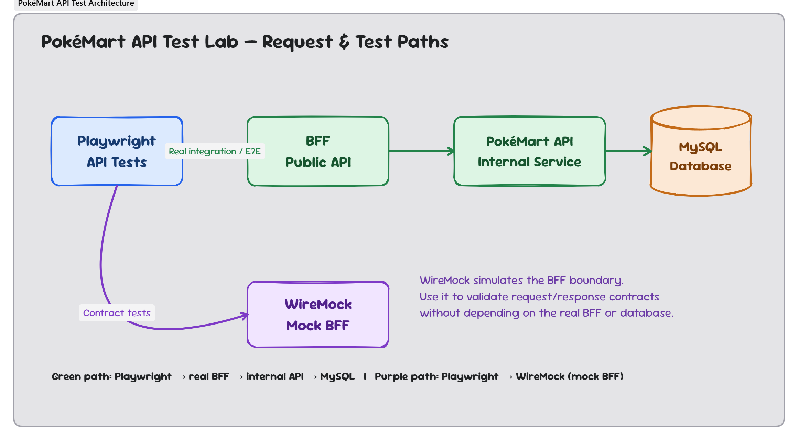
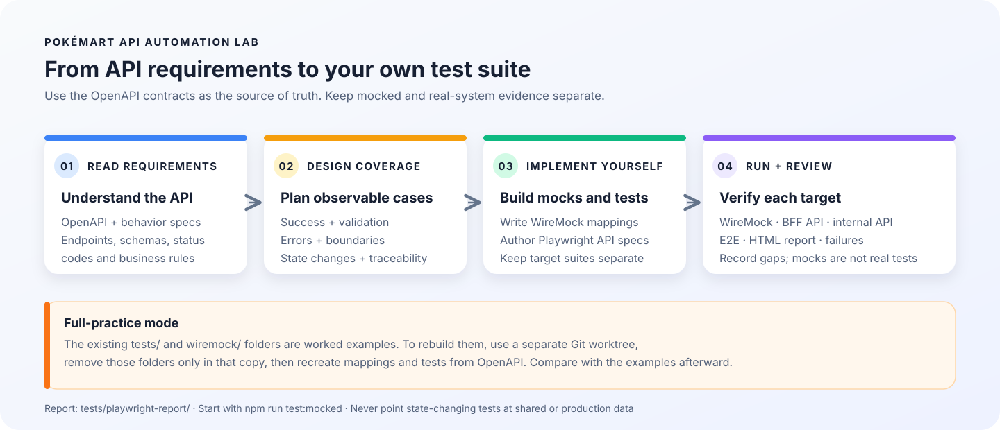
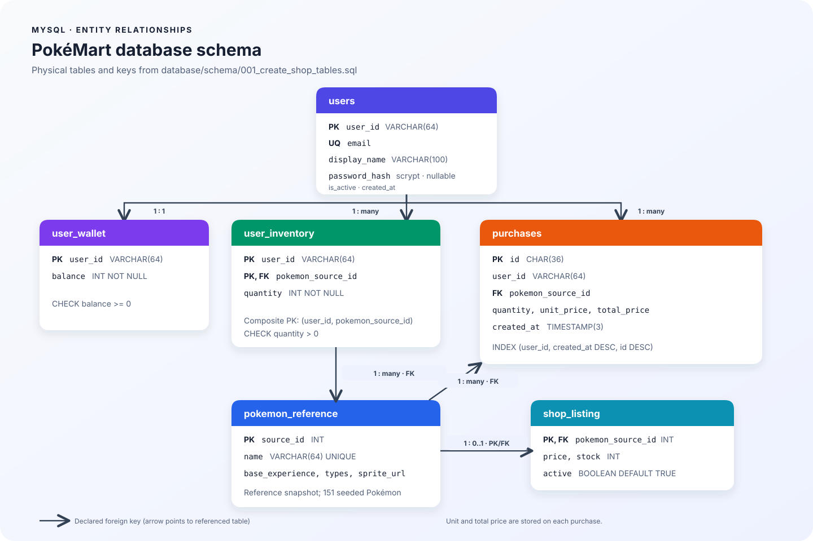

# PokéMart API Automation Lab

โปรเจ็กต์สำหรับฝึก API testing ด้วย Playwright และ TypeScript ประกอบด้วย public BFF, internal PokéMart API, MySQL, WireMock และ OpenAPI/Swagger UI ข้อมูล Pokémon แบบ static ช่วยให้เริ่มระบบและทดสอบซ้ำได้โดยไม่ต้องเรียก PokéAPI ทุกครั้ง

## สถาปัตยกรรม





| Service | URL เมื่อรัน local | หน้าที่ |
|---|---|---|
| BFF | `http://localhost:3001` | Public API สำหรับ client และแปลง response เป็น DTO ฝั่ง public |
| PokéMart API | `http://localhost:3000` | Internal service สำหรับ business rules และการเข้าถึงข้อมูล |
| WireMock | `http://localhost:8080` | จำลอง public API สำหรับ contract tests |
| Swagger UI | `http://localhost:8081` | เลือกดู BFF OpenAPI หรือ internal API OpenAPI |
| MySQL | `localhost:3307` (host; port ใน container คือ `3306`) | เก็บ catalog, wallet, inventory และ purchase history |

## 1. Prerequisites

จำเป็นต้องมี:

1. **Node.js 22 LTS และ npm**
2. **Docker Desktop** (Windows/macOS) หรือ Docker Engine ที่มี Docker Compose v2 (Linux)
3. **Git** เฉพาะเมื่อต้อง clone repository

GNU Make เป็นทางเลือกเท่านั้น คู่มือนี้ใช้ `npm` และ `docker compose` ซึ่งใช้ได้ทั้ง Windows และ macOS โดยไม่ต้องติดตั้ง Make เพิ่ม

เปิด Docker Desktop ให้ทำงานก่อนเริ่ม แล้วตรวจสอบใน terminal:

```text
node --version       # ควรเป็น v22.x
npm --version
docker --version
docker compose version
```

ใช้ **PowerShell** บน Windows หรือ **Terminal (zsh)** บน macOS แล้วเปิด terminal ที่ root ของ repository (โฟลเดอร์ที่มี `package.json` และ `docker-compose.yml`)

## 2. Setup ครั้งแรก

### Windows — PowerShell

1. สร้าง `.env` หากยังไม่มี แล้วเปิดไฟล์และตั้ง `MYSQL_HOST_PORT=3307` ให้ตรงกับ `MYSQL_PORT=3307` ใน `tests/configs/.env.test`:

   ```powershell
   if (-not (Test-Path .env)) { Copy-Item .env.example .env }
   ```

2. ติดตั้ง dependencies, build แอป และเริ่ม services:

   ```powershell
   npm ci
   npm run build
   docker compose up -d --build
   ```

3. ตรวจสถานะและ readiness ก่อนทดสอบ:

   ```powershell
   docker compose ps
   curl.exe -fsS http://localhost:3001/health
   curl.exe -fsS http://localhost:3001/ready
   curl.exe -fsS http://localhost:3000/ready
   ```

### macOS — Terminal (zsh)

1. สร้าง `.env` หากยังไม่มี แล้วตั้ง `MYSQL_HOST_PORT=3307` ให้ตรงกับ `MYSQL_PORT=3307` ใน `tests/configs/.env.test`:

   ```zsh
   if [ ! -f .env ]; then cp .env.example .env; fi
   ```

2. ติดตั้ง dependencies, build แอป และเริ่ม services:

   ```zsh
   npm ci
   npm run build
   docker compose up -d --build
   ```

3. ตรวจสถานะและ readiness ก่อนทดสอบ:

   ```zsh
   docker compose ps
   curl --fail --silent --show-error http://localhost:3001/health
   curl --fail --silent --show-error http://localhost:3001/ready
   curl --fail --silent --show-error http://localhost:3000/ready
   ```

MySQL จะสร้าง schema และ seed data เมื่อเริ่มด้วย volume ใหม่ เปิด Swagger UI ที่ `http://localhost:8081` แล้วเลือก **BFF Public API** หรือ **PokéMart Internal API** ได้เลย

> ค่าใน `.env.example` เป็น local-development values เท่านั้น ห้ามใช้กับ shared/production environment หรือ commit `.env` และ credentials จริง

## ทดลอง login และเรียก API

เมื่อระบบพร้อมแล้ว สามารถทดลอง login ด้วย demo account ที่ seed มาได้ (สำหรับ local lab เท่านั้น):

### Windows — PowerShell

```powershell
$login = Invoke-RestMethod -Method Post http://localhost:3001/api/auth/login -ContentType 'application/json' -Body '{"email":"lab-user-001@example.test","password":"PokeMartLab!2026"}'
$headers = @{ Authorization = "Bearer $($login.accessToken)" }
Invoke-RestMethod http://localhost:3001/api/auth/me -Headers $headers
Invoke-RestMethod http://localhost:3001/api/wallet -Headers $headers
```

### macOS — Terminal

```zsh
TOKEN=$(curl --fail --silent --show-error -X POST http://localhost:3001/api/auth/login \
  -H 'Content-Type: application/json' \
  -d '{"email":"lab-user-001@example.test","password":"PokeMartLab!2026"}' | node -p "JSON.parse(require('fs').readFileSync(0, 'utf8')).accessToken")
curl --fail --silent --show-error http://localhost:3001/api/auth/me -H "Authorization: Bearer $TOKEN"
curl --fail --silent --show-error http://localhost:3001/api/wallet -H "Authorization: Bearer $TOKEN"
```

Login returns a one-hour JWT. A frontend should send it as `Authorization: Bearer <accessToken>` for wallet, inventory, and purchase requests; catalog reads are public. No signup or password-reset flow is included. Replace the local-only `AUTH_JWT_SECRET`, enable HTTPS, and add rate limiting and a refresh/revocation strategy before exposing this flow beyond the lab.

## 3. รันทดสอบ — Step by step

เริ่มจาก WireMock เพื่อฝึก mapping แล้วค่อยทดสอบ API จริงและ end-to-end:

| ขั้นตอน | npm command | ตรวจสอบอะไร | เป้าหมาย |
|---|---|---|---|
| 1 | `npm run test:mocked` | WireMock scenarios, mapping และ error response | WireMock; ไม่ทดสอบ logic ของ BFF จริง |
| 2 | `npm run test:api` | Public API validation กับ BFF จริง | BFF + PokéMart API + MySQL |
| 3 | `npm run test:pokeapi` | Contract ของ internal API แยกตาม endpoint | PokéMart API + MySQL |
| 4 | `npm run test:purchase-retry` | Retry ด้วย `purchaseId` เดิมและ duplicate หลัง commit | ระบบจริง + MySQL |
| 5 | `npm run test:e2e` | User journeys และผลกระทบต่อข้อมูล | BFF + PokéMart API + MySQL |
| ทั้งหมด | `npm test` | ทุก Playwright project | ต้อง start Compose |

รันตามลำดับตัวอย่าง:

```text
npm run test:mocked
npm run test:api
npm run test:pokeapi
npm run test:purchase-retry
npm run test:e2e
```

### ผลลัพธ์และ HTML report

Playwright แสดงผลใน terminal และสร้าง report ที่ `tests/playwright-report/` ทุกครั้งที่ทดสอบ หากต้องการเปิด HTML report:

```text
npm run test:report
```

ตรวจผลผ่าน terminal ได้ทันที หรือเปิด report เพื่อดู pass/fail, error details และ test ที่ล้มเหลว อย่าตีความ WireMock pass ว่าเป็นหลักฐานว่า BFF หรือฐานข้อมูลจริงทำงานถูกต้อง

ทุก suite แยก test files ตาม target และ endpoint: `tests/testCases/mocked-bff/` สำหรับ WireMock, `pokemon/` และ `purchases/` สำหรับ public BFF, `PokeAPI/<endpoint>/` สำหรับ internal PokéMart API โดยตรง และ `e2e/` สำหรับ journeys ผ่าน BFF ผลจาก WireMock ยืนยันเฉพาะ contract ของ mapping ไม่ได้ยืนยัน business logic หรือ persistence ของระบบจริง ส่วน `PokeAPI` ตรวจ internal DTO/error behavior โดยไม่ใช้ BFF.

`npm test` รัน WireMock และ real-system projects แยกกัน ไม่ได้ส่ง purchase ซ้ำจาก WireMock ไปยังฐานข้อมูลจริง แต่ละ purchase test ใช้ UUID ใหม่และตรวจ duplicate ภายในเคสของตัวเอง ก่อน project `api`, `e2e` หรือ `pokeapi` เริ่ม จะมี setup ตั้ง wallet ของ `REAL_USER_ID` และ listing ของ `REAL_POKEMON_ID` กลับเป็น `REAL_WALLET_BALANCE`, `REAL_POKEMON_PRICE`, `REAL_POKEMON_STOCK` และ active พร้อมลบ inventory row ของ user/โปเกมอนคู่นั้น การตั้งค่านี้ไม่ลบ purchase history หรือ reset Docker volume; purchase tests ยัง snapshot/restore state และลบ purchase ที่สร้างเอง

> **สำคัญ:** setup นี้เขียนข้อมูลใน MySQL จึงต้องใช้ database และ user สำหรับทดสอบที่แยกจากข้อมูลใช้งานจริงเท่านั้น การรัน real-system tests จะคืนยอด wallet และ listing ที่เลือกเป็นค่าตั้งต้นตาม config เสมอ; ใช้ `npm run test:mocked` หากต้องการทดสอบ WireMock โดยไม่เรียก setup หรือเชื่อม MySQL

## เลือก environment ของ test

`TEST_ENV` ใช้เลือก URLs และ test data โดยไม่เปลี่ยน test case ค่าเริ่มต้นคือ `test` และโหลดจาก `tests/configs/.env.test`; ตัวเลือกอื่นที่เตรียมไว้คือ `sit` และ `stg`:

PowerShell:

```powershell
$env:TEST_ENV='test'; npm test
$env:TEST_ENV='sit'; npm run test:api
```

macOS / zsh:

```zsh
TEST_ENV=test npm test
TEST_ENV=sit npm run test:api
```

กำหนดค่า SIT/STG จริงใน `tests/configs/.env.sit` หรือ `.env.stg` ก่อนใช้งาน ไฟล์ตัวอย่างมี URL placeholder และห้ามใส่ credentials จริงลงใน Git การรัน real-system project จะ reset เฉพาะ wallet และ listing ที่ระบุ พร้อมลบ inventory row ของ user/โปเกมอนที่เลือก ดังนั้นต้องใช้ user และ MySQL database ที่แยกไว้สำหรับ test โดยเฉพาะ ห้ามชี้ไปยัง production หรือข้อมูล shared ที่ไม่อนุญาตให้แก้ไข ใน environment ที่ไม่ใช่ `test` การเชื่อมต่อฐานข้อมูลจะ fail หากไม่ได้กำหนด `MYSQL_HOST`, `MYSQL_DATABASE`, `MYSQL_USER` และ `MYSQL_PASSWORD` ไว้ชัดเจน

`MYSQL_HOST_PORT` ใน `.env` คือ port ที่ Docker เปิดบน host ส่วน `MYSQL_PORT` ในไฟล์ `tests/configs/.env.*` คือ port ที่ test runner ใช้เชื่อมต่อจาก host ทั้งสองค่าต้องตรงกัน เช่น `MYSQL_HOST_PORT=3307` ต้องคู่กับ `MYSQL_PORT=3307`

## Build, stop และจัดการฐานข้อมูล

```bash
npm run build
docker compose ps
docker compose logs -f
docker compose down
```

- `docker compose logs -f` แสดง logs ต่อเนื่อง กด `Ctrl+C` เพื่อหยุดการติดตาม logs (ไม่ได้หยุด containers)
- `docker compose down` หยุด containers โดยไม่ลบ database volume
- GNU Make ยังคงใช้ได้เป็นทางเลือก: `make help` แสดง targets ทั้งหมด และ `make db-reset` **ลบ Compose volumes และข้อมูล local ทั้งหมด** ห้ามใช้กับ SIT, shared หรือ production data

## แบบฝึกหัด: สร้าง WireMock และ tests เอง

โฟลเดอร์ `tests/` และ `wiremock/` ที่ให้มาเป็นตัวอย่างเต็มรูปแบบ ให้อ่าน requirements ก่อน แล้วสร้าง mapping และ Playwright tests ของตัวเองจาก OpenAPI โดยไม่เปิดดูตัวอย่างระหว่างทำ หากต้องการเริ่มใหม่ทั้งสองโฟลเดอร์ ให้ทำใน worktree แยกเพื่อเก็บตัวอย่างและงานปัจจุบันไว้:

```text
git worktree add ..\PokeMart-practice -b practice/rebuild-tests
```

บน macOS ใช้ path แบบนี้:

```zsh
git worktree add ../PokeMart-practice -b practice/rebuild-tests
```

จากนั้นเข้าโฟลเดอร์และลบ `tests/` กับ `wiremock/` เฉพาะใน worktree ใหม่นั้น:

```powershell
Set-Location ..\PokeMart-practice
Remove-Item -Recurse -Confirm -Path tests, wiremock
```

บน macOS:

```zsh
cd ../PokeMart-practice
rm -ri tests wiremock
```

สร้างโครงสร้าง/config, mappings และ test cases ใหม่ โปรเจ็กต์ root กำหนด `tests` เป็น npm workspace จึงต้องสร้าง `tests/package.json` และ Playwright config กลับมาก่อนรัน `npm install`/tests

เริ่มออกแบบจาก [BFF OpenAPI](specs/openapi.yaml), [internal API OpenAPI](specs/pokemart-openapi.yaml), [acceptance criteria](specs/06-acceptance-and-decisions.md) และ [test design / traceability](specs/08-test-design.md) แล้วใช้แผนภาพสถาปัตยกรรมและ workflow ที่ฝังใน README นี้ช่วยแยก real กับ mocked tests

## Purchase request และ retry

Client สร้าง UUID `purchaseId` ก่อนเริ่มซื้อ และส่ง ID นี้ใน JSON body ไม่ใช้ `Idempotency-Key` header:

```json
{
  "purchaseId": "00000000-0000-4000-8000-000000000001",
  "pokemonId": 1,
  "quantity": 1
}
```

- ใช้ `purchaseId` เดิมเมื่อต้อง retry purchase รายการเดิม
- หาก request ล้มเหลวก่อน transaction commit จะไม่มีการจอง ID และ retry ด้วย ID เดิมได้
- หาก purchase commit แล้ว การส่ง ID เดิมอีกครั้งจะได้ `409 PURCHASE_DUPLICATE` โดยไม่หัก wallet หรือ stock ซ้ำ
- หากไม่แน่ใจว่าคำขอ commit แล้วหรือไม่ ให้ตรวจ `GET /api/purchases/{purchaseId}` ก่อน retry

## ฐานข้อมูลและ Pokémon seed

ฐานข้อมูลใช้ SQL ใน `database/schema/` และ `database/seed/`; การ initialize อัตโนมัติทำงานเมื่อสร้าง MySQL volume ใหม่เท่านั้น Seed ปัจจุบันมี Pokémon Generation I 151 ตัวจาก PokeAPI v2 พร้อมราคาและ stock จำลองของ PokéMart

### ERD: ตารางและความสัมพันธ์



ทุกเส้นใน ERD คือ foreign key ที่ประกาศใน MySQL รวมถึง `users.user_id` ที่เชื่อมกับ wallet, inventory และ purchases คัดลอก DBML ไปใช้ใน dbdiagram.io ได้จาก [database/schema/pokemart.dbml](database/schema/pokemart.dbml); ดูรายละเอียดคอลัมน์และ constraints ที่ [database/README.md](database/README.md).

ราคา derive จาก base experience ปัดทีละ 50 และจำกัดช่วง 200–1500 ส่วน stock ลดลงตาม experience tier และมี variation แบบ deterministic จาก Pokémon ID ทำให้ seed ซ้ำได้ผลเดิม Runtime และ tests ไม่เรียก PokéAPI ดูรายละเอียดที่ [database/README.md](database/README.md) และข้อมูลใน [database/seed/001_seed_shop_data.sql](database/seed/001_seed_shop_data.sql)

ที่มาข้อมูล: [PokeAPI REST API](https://pokeapi.co/) โปรดตรวจสอบ license/attribution ก่อนนำ snapshot ไปเผยแพร่ต่อ

## API specifications และเอกสาร

- Public BFF OpenAPI: [specs/openapi.yaml](specs/openapi.yaml)
- Internal PokéMart API OpenAPI: [specs/pokemart-openapi.yaml](specs/pokemart-openapi.yaml)
- API behavior และ error contracts: [specs/03-api-contract.md](specs/03-api-contract.md)
- Testing approach: [specs/04-testing.md](specs/04-testing.md)
- Public/internal API test design, traceability และ coverage gaps: [specs/08-test-design.md](specs/08-test-design.md)
- Database, seed และ migration: [database/README.md](database/README.md)
- โครงสร้าง Playwright: [Playwright structure.md](Playwright%20structure.md)
