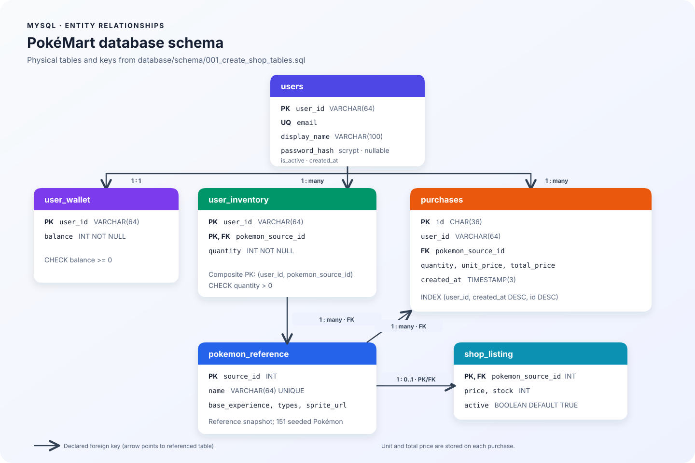

# Database

Liquibase applies the schema and seed data (see [Schema migrations](#schema-migrations-liquibase) below); MySQL itself no longer runs the SQL files. The deterministic baseline contains 1,025 main National Pokédex Pokémon and 2,222 canonical PokeAPI item names. The checked-in SQL seed is the runtime source of truth; normal startup and tests do not require an `api-data` checkout or call PokéAPI. A duplicate Roseli Berry resource in the source is intentionally canonicalized to its lowest source ID.

## Schema and relationships

The diagram reflects the physical schema in [`schema/001_create_shop_tables.sql`](schema/001_create_shop_tables.sql). `pokemon_reference` is the shared catalog; a listing may be present for each catalog Pokémon, while inventory and purchase rows refer back to that Pokémon. The arrows label cardinality from `pokemon_reference` to the related table.

### Open or edit the ERD in dbdiagram.io

The copyable DBML source is [`schema/pokemart.dbml`](schema/pokemart.dbml). In dbdiagram.io, create a diagram, then copy and paste the complete contents of that file into the editor. The named `Ref` lines match the actual foreign keys from the SQL schema.

### Columns and keys

| Table | Column | MySQL type | Null | Key / rule |
|---|---|---|---|---|
| `pokemon_reference` | `source_id` | `INT` | No | PK |
| | `name` | `VARCHAR(64)` | No | UNIQUE |
| | `base_experience` | `SMALLINT UNSIGNED` | No | |
| | `types` | `JSON` | No | |
| | `sprite_url` | `VARCHAR(512)` | Yes | |
| `users` | `user_id` | `VARCHAR(64)` | No | PK |
| | `email` | `VARCHAR(254)` | No | UNIQUE |
| | `display_name` | `VARCHAR(100)` | No | |
| | `password_hash` | `VARCHAR(255)` | Yes | scrypt hash; NULL until credentials are provisioned |
| | `is_active` | `BOOLEAN` | No | DEFAULT `TRUE` |
| | `created_at` | `TIMESTAMP(3)` | No | DEFAULT `CURRENT_TIMESTAMP(3)` |
| `shop_listing` | `pokemon_source_id` | `INT` | No | PK, FK → `pokemon_reference.source_id` |
| | `price` | `INT` | No | CHECK `price >= 0` |
| | `stock` | `INT` | No | CHECK `stock >= 0` |
| | `active` | `BOOLEAN` | No | DEFAULT `TRUE` |
| `item_reference` | `source_id` | `INT` | No | PK |
| | `name` | `VARCHAR(128)` | No | UNIQUE |
| | `pokeapi_cost` | `INT UNSIGNED` | No | DEFAULT `0` |
| | `category` | `VARCHAR(128)` | Yes | |
| | `sprite_url` | `VARCHAR(512)` | Yes | |
| `item_listing` | `item_source_id` | `INT` | No | PK, FK → `item_reference.source_id` |
| | `price`, `stock` | `INT` | No | CHECK `>= 0` |
| | `active` | `BOOLEAN` | No | DEFAULT `TRUE` |
| | `required_kyc_level` | `TINYINT UNSIGNED` | No | CHECK 0–2 |
| `user_wallet` | `user_id` | `VARCHAR(64)` | No | PK, FK → `users.user_id` (one-to-one) |
| | `balance` | `INT` | No | CHECK `balance >= 0` |
| `user_inventory` | `user_id` | `VARCHAR(64)` | No | Composite PK, FK → `users.user_id` |
| | `pokemon_source_id` | `INT` | No | Composite PK, FK → `pokemon_reference.source_id` |
| | `quantity` | `INT` | No | CHECK `quantity > 0` |
| `purchases` | `id` | `CHAR(36)` | No | PK; client-generated UUID |
| | `user_id` | `VARCHAR(64)` | No | FK → `users.user_id`; included in `idx_purchase_user_created` |
| | `pokemon_source_id` | `INT` | No | FK → `pokemon_reference.source_id` |
| | `quantity` | `INT` | No | CHECK 1–99 |
| | `unit_price` | `INT` | No | Price snapshot |
| | `total_price` | `INT` | No | Price snapshot |
| | `created_at` | `TIMESTAMP(3)` | No | DEFAULT `CURRENT_TIMESTAMP(3)` |
| `user_item_inventory` | `user_id`, `item_source_id` | `VARCHAR(64)`, `INT` | No | Composite PK; FK → users/item_reference |
| | `quantity` | `INT` | No | CHECK `> 0` |
| `item_purchases` | `id` | `CHAR(36)` | No | PK; client-generated UUID |
| | `user_id`, `item_source_id` | `VARCHAR(64)`, `INT` | No | FK → users/item_reference |
| | `quantity` | `INT` | No | CHECK 1–99 |
| | `unit_price`, `total_price` | `INT` | No | Price snapshots |

The remaining index columns are `created_at DESC, id DESC` in `idx_purchase_user_created`. The composite inventory primary key is `(user_id, pokemon_source_id)`.

The fresh-volume seed provisions the demo account `lab-user-001@example.test`, its wallet, and KYC `level` 1 (the KYC service seeds it; level 1 can shop). Changeset `007-seed-kyc-test-users` adds 29 `lab-kyc-*` accounts, one per KYC test case, each with its own wallet and the same demo password; their KYC level and status are set by the tests themselves. Sign in with password `PokeMartLab!2026` for local practice only. It also creates `lab-empty-user-001`, a test-only active profile with no wallet or password. Passwords are stored as scrypt hashes, never plaintext. The schema does not include a public registration or password-reset endpoint; legacy profiles have a NULL password hash and cannot sign in until credentials are provisioned.

Authentication uses one-hour HS256 access tokens. The API checks the JWT signature, issuer, audience, expiry, and active user record on protected wallet, inventory, and purchase operations. Catalog reads stay public. Configure `AUTH_JWT_SECRET` with at least 32 random bytes outside the local lab; the default Compose secret and seeded credentials are development-only. Use HTTPS, rate limiting, secret management, and a refresh/revocation strategy before production use. A stateless token cannot be explicitly logged out; the client should discard it.

User IDs are foreign-key constrained: one user has at most one wallet, and may have many Pokémon/item inventory and purchase rows. Purchase prices are snapshots; a purchase does not reference a shop listing. The schema has no `idempotency_keys` table: a committed purchase ID is protected by the relevant purchase table's primary key.

The generated reference seed is pinned at PokeAPI/api-data commit `447bd5c378bf87da964bfe4dd7487a7bf1d97cbd`. Pokémon price derives from base experience, item price derives from the recorded PokeAPI cost, and stock is deterministic. KYC tiers: level 0 buys nothing; every Pokémon and ordinary item listing needs level 1; the Master tier (Master Ball, Full Restore, Max Potion/Revive/Ether/Elixir, Revival Herb, PP Max, Sacred Ash) needs level 2. Changeset `006-kyc-catalog-levels` applies this on top of the catalog seed. All price, stock, activation, and KYC rules are fictional PokéMart-owned data.

PokeAPI data: [PokeAPI REST API](https://pokeapi.co/) and [PokeAPI project](https://github.com/PokeAPI/pokeapi). Review the applicable license and attribution terms before redistributing or publishing the snapshot.

## Schema migrations (Liquibase)

`database/liquibase/db.changelog-master.yaml` is the single list of database changes. A one-shot `liquibase` service in `docker-compose.yml` applies it after MySQL is healthy, and the API, BFF and shipping worker only start once it has finished successfully, so nothing ever runs against an empty database. Liquibase records what it applied in the `DATABASECHANGELOG` table, so running it again does nothing.

| Command | What it does |
|---|---|
| `make up` | Starts everything, including the migration step |
| `make db-migrate` | Applies pending changesets (safe to repeat) |
| `make db-status` | Lists which changesets are applied or pending |
| `make db-adopt` | **One time, for a volume created before Liquibase:** records the baseline as already applied without running it |
| `make db-reset` | **Destructive.** Deletes the volume and re-applies every changeset |

The baseline changesets point at the existing files, so there is nothing to keep in sync: `001-baseline-schema` runs `schema/001_create_shop_tables.sql` (the schema with migrations 001-006 already folded in) and the `seed` changesets run `seed/*.sql`. Two contexts exist: `schema` and `seed`; set `LIQUIBASE_CONTEXTS=schema` to get an empty schema.

To change the schema, add a new numbered `changeSet` at the end of the master changelog (a `sqlFile` pointing at a new file in `database/migrations/` works well). Never edit a changeset that has already been applied; Liquibase stores a checksum of each one and will refuse to continue. Keep `schema/001_create_shop_tables.sql` and `pokemart.dbml` equal to the end result, because `001-baseline-schema` is the starting point for a new database.

The numbered files `migrations/001`-`006` are history. They are already part of the baseline, so a volume created with the current flow never needs them. A volume created before the user-identity rename, the `idempotency_keys` removal, user foreign keys, or the item/KYC/payment tables should be recreated with `make db-reset` rather than patched by hand; the notes below describe what each of those files did.

Existing volumes created before the user-identity rename needed `database/migrations/001_rename_player_identity.sql` applied once.

Existing volumes that contain the retired `idempotency_keys` table needed `database/migrations/002_drop_idempotency_keys.sql` once. New volumes do not create that table.

Existing volumes needed `database/migrations/003_add_users_and_foreign_keys.sql` once. It creates user profiles for existing wallet, inventory, and purchase IDs, then adds the user foreign keys. Existing IDs receive placeholder `.invalid` email addresses except for the lab demo user; password hashes remain NULL until credentials are provisioned.

Existing volumes created before item catalog, KYC, or payment support needed `database/migrations/005_add_catalog_items_payment_and_kyc.sql`, and `database/migrations/006_add_item_purchases.sql` for item checkout. The baseline schema already contains all of these tables.

`make db-reset` deletes the local Compose volume, then re-applies every Liquibase changeset, and is destructive. It must never be used for shared or production data.
