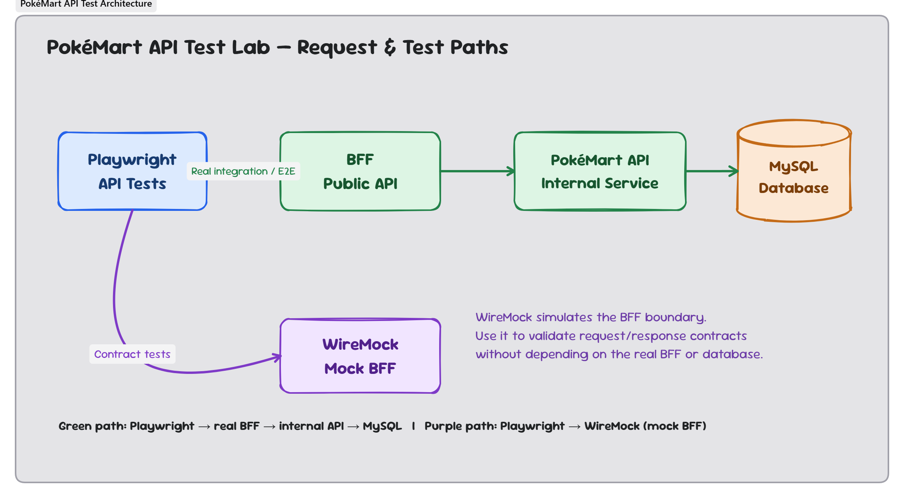

# PokéMart API Automation Lab

โปรเจ็กต์ตัวอย่างสำหรับฝึก API testing ด้วย Playwright และ TypeScript พร้อมเว็บแอป Next.js มี BFF, PokéMart API, MySQL, WireMock และ OpenAPI/Scalar UI โดยใช้ข้อมูล Pokémon แบบ static เพื่อให้ทดสอบซ้ำได้โดยไม่ต้องเรียก PokéAPI ทุกครั้ง

## สถาปัตยกรรม

> เพิ่ม Shipping integration lab ตาม [`10-shipping-integration.md`](10-shipping-integration.md): PokéMart บันทึก shipment job ลง MySQL แล้ว worker เรียก Express Shipping Mock ผ่าน HTTP; การทดสอบส่วนนี้ไม่ใช้ WireMock.



- **BFF** เป็นทางเข้าสำหรับ client ที่ `/api` ตรวจ request, ส่งต่อไปยัง service และดูแล contract ฝั่ง public
- **PokéMart API** อยู่ใต้ `/pokemart/v1` และเป็นเจ้าของ business rules, purchase, duplicate detection และการเข้าถึงฐานข้อมูล
- **MySQL** เก็บข้อมูลร้าน (Pokémon และ item), wallet/top-up, inventory, purchase และสถานะ/งาน shipment ของทั้ง Pokémon และ item ที่ต้อง retry (ข้อมูล KYC อยู่ใน KYC API ไม่ใช่ MySQL)
- **Payment Mock** จำลอง PaymentIntent สำหรับ top-up แบบ idempotent โดยไม่มีเงินจริงเคลื่อนย้าย
- **Shipping Mock** เป็น HTTP service จำลองผู้ให้บริการขนส่งภายนอก; **Shipping Worker** ทำ batch/retry แยกจาก request ของผู้ซื้อ
- **WireMock** ใช้จำลอง BFF สำหรับ contract tests เท่านั้น การทดสอบ integration จริงต้องเรียก BFF และ service จริง
- การทดสอบและการเริ่มระบบไม่ควรต้องเรียก PokéAPI แบบ live

## ความต้องการก่อนเริ่ม

- Node.js และ npm (ใช้เวอร์ชัน LTS ที่รองรับ)
- Podman พร้อม podman-compose และ GNU Make (ดูขั้นตอนใน README หัวข้อ Prerequisites)
- GNU Make เป็นตัวเลือก หากต้องการใช้คำสั่ง `make`

## เริ่มใช้งานบน Windows

เปิด PowerShell ที่โฟลเดอร์โปรเจ็กต์:

```powershell
Copy-Item .env.example .env
npm install
make up
```

ตรวจสอบสถานะและ readiness:

```powershell
make ps
Invoke-RestMethod http://localhost:4001/health
Invoke-RestMethod http://localhost:4001/ready
Invoke-RestMethod http://localhost:4000/ready
```

ค่าเริ่มต้นของ host ports: PokéMart API `4000`, BFF `4001`, Shipping Mock `4002`, Web `4003`, Payment Mock `4004`, KYC API `4005`, MySQL `4306`, WireMock `8080`, Scalar UI `8081` (ตารางเต็มอยู่ใน [`05-operations.md`](05-operations.md) §11.1) หาก port MySQL ในเครื่องถูกใช้อยู่ ให้กำหนด `MYSQL_HOST_PORT` ใน `.env` เป็น port ว่างก่อน start ระบบ

## API และ Scalar

| สิ่งที่เรียก | Base URL | Contract |
|---|---|---|
| Public BFF | `http://localhost:4001` | [`specs/openapi.yaml`](specs/openapi.yaml) |
| Internal PokéMart API | `http://localhost:4000` | [`specs/pokemart-openapi.yaml`](specs/pokemart-openapi.yaml) |
| Scalar API reference | `http://localhost:8081` | เลือกดู BFF public API, PokéMart internal API, KYC, Payment mock และ Shipping mock จากเมนูด้านซ้าย |
| WireMock | `http://localhost:8080` | Mappings ใน `wiremock/mappings/` สำหรับ mocked-BFF suite |
| Shipping Mock | host port ที่กำหนดใน Compose | [`shipping-mock-openapi.yaml`](shipping-mock-openapi.yaml) และ [`10-shipping-integration.md`](10-shipping-integration.md) |

**สถานะ API docs:** ใช้ Scalar แทน Scalar UI; Compose mount ไฟล์ OpenAPI ทั้งห้าไฟล์ที่ `/docs` และ Scalar สร้างรายการให้อัตโนมัติ (`make docs` แสดง URL)

### Endpoints ที่มีใน contract

Public API:

- `GET /api/pokemon` และ `GET /api/pokemon/{id}`
- `GET /api/wallet`, `POST /api/wallet/top-ups`, `GET /api/wallet/top-ups/{topUpId}`, `GET /api/kyc/status` และ `POST /api/kyc/submissions`
- `GET /api/inventory`
- `GET /api/purchases` (ประวัติรวม Pokémon และ item, กรองด้วย `?kind=POKEMON|ITEM` ได้) และ `GET /api/purchases/{id}`
- `GET /api/purchases/{id}/shipment`
- `GET /api/items/inventory`
- `POST /api/purchases` (ส่ง `purchaseId`, `quantity` และ `pokemonId` หรือ `itemId` อย่างใดอย่างหนึ่งใน JSON body)
- `GET /health` และ `GET /ready`

Internal service ใช้ endpoints ที่สอดคล้องกันภายใต้ `/pokemart/v1` เช่น `/pokemart/v1/catalog/pokemon`, `/pokemart/v1/auth/login`, `/pokemart/v1/wallet` และ `/pokemart/v1/purchases`; wallet, inventory และ purchase resources ต้องใช้ bearer JWT

## คำสั่ง build และทดสอบ

```powershell
npm run build
npm test
npm run test:mocked
npm run test:api
npm run test:purchase-retry
npm run test:e2e
```

- Test cases แยกตามหน้าที่และ target: `tests/testCases/mocked-bff/`, `pokemon/`, `purchases/` และ `e2e/`; ไม่แชร์ไฟล์ scenario ระหว่าง WireMock กับระบบจริง
- `test:mocked` รันเฉพาะ WireMock scenarios และตรวจ mock mappings
- `test:api` รัน API validation กับ BFF จริง
- `test:purchase-retry` และ `test:e2e` รัน flow จริง รวมการตรวจผลกระทบต่อ state และต้อง start Compose
- เลือก URL และ test data ด้วย `TEST_ENV` (`test` เป็นค่าเริ่มต้น หรือ `sit`) ผ่าน `tests/configs/.env.test` และ `.env.sit` เช่น `$env:TEST_ENV='sit'; npm test` ใน PowerShell
- ผลจาก mock ไม่เท่ากับการยืนยันพฤติกรรมของระบบจริง ขอบเขตการทดสอบแยกไว้ใน [`04-testing.md`](04-testing.md)

คำสั่ง `make` ที่มีให้ใช้ ได้แก่ `make up`, `make down`, `make ps`, `make logs`, `make docs`, `make test-*`, `make db-seed` และ `make db-reset` (ขึ้นกับ GNU Make ในเครื่อง) โดย `make down` ไม่ลบข้อมูล ส่วน `make db-reset` ลบ Compose volumes และข้อมูลฐานข้อมูลในเครื่อง

## ฐานข้อมูลและข้อมูลอ้างอิง PokéAPI

ฐานข้อมูลเริ่มต้นจาก SQL ใน `database/schema/` และ `database/seed/` ซึ่ง Liquibase นำไปใช้ให้ (รันซ้ำได้ปลอดภัย) seed มี Pokémon 1,025 ตัวและ item 2,222 รายการจาก PokeAPI snapshot ที่ pin commit แล้ว พร้อมราคา/stock/KYC จำลองของ PokéMart

ราคา Pokémon ใช้ base experience คำนวณแล้วปัดทีละ 50 และราคา item ใช้ PokéAPI cost เป็นฐาน; Pokémon และ item ทั่วไปต้องมี KYC level 1 ส่วน item ระดับ Master (เช่น Master Ball และยาระดับสูง) ต้อง level 2 และ level 0 ซื้ออะไรไม่ได้เลย ข้อมูลที่ generate อยู่ใน `010_reference_pokemon.sql`, `011_reference_items.sql` และ `012_seed_catalog.sql`; runtime/test ไม่เรียก PokéAPI

ที่มาข้อมูล: [PokeAPI REST API](https://pokeapi.co/). ตรวจสอบ license/attribution ก่อนนำ snapshot ไปแจกจ่ายต่อ

## สิ่งที่ปรับปรุงทางเทคนิค

### WireMock

- มี success mappings สำหรับ public endpoints รวม health/readiness และ error scenario mappings สำหรับ error codes ใน contract
- `contract.spec.ts` ตรวจ shape/status/error envelope และ reset request journal ก่อนแต่ละ test
- Error mappings ใช้ `X-WireMock-Scenario` เป็น selector สำหรับ mocked tests เท่านั้น ไม่ใช่ header ของ public API

### Identity

- ใช้ `userId`, `user_id`, `users`, `user_wallet` และ `user_inventory` ให้สอดคล้องกัน
- มี local demo login ด้วย email/password และ JWT สำหรับฝึก; ยังไม่ใช่ production-grade authentication
- Schema และ seed data ถูกจัดการด้วย Liquibase (`database/liquibase/db.changelog-master.yaml`); `make up` รัน migration ให้เองก่อนที่ API/BFF จะเริ่ม, ไฟล์ `database/migrations/001-006` เป็นประวัติที่รวมอยู่ใน baseline แล้ว
- Volume เดิมที่มีตาราง `idempotency_keys` ให้รัน `database/migrations/002_drop_idempotency_keys.sql` หลัง migration 001

### Reference-data seed

- มี Pokémon 1,025 ตัวและ item ชื่อไม่ซ้ำ 2,222 รายการจาก snapshot ที่ generate และ commit แล้ว; ไม่ต้องเก็บ clone `api-data` ไว้ในโปรเจ็กต์
- ราคา/stock เป็นข้อมูลจำลองของร้าน; Pokémon และ item ทั่วไปต้อง KYC level 1, item ระดับ Master ต้อง level 2 ตามกติกาใน [database/README.md](database/README.md)

### BFF DTO

- BFF แปลงข้อมูลจาก service เป็น public response DTO: catalog ใช้ `totalCount/page/items`, wallet อยู่ใต้ `wallet`, inventory มี nested Pokémon และ purchase ใช้ `purchaseId` กับกลุ่ม `pricing`
- Internal API ยังคง contract ของ service แยกต่างหาก ไม่ serialize body ตรงกลับ client

### Purchase retry behavior

- Client สร้าง UUID `purchaseId` ก่อนส่งคำขอ และใส่ลง JSON body; ไม่ใช้ `Idempotency-Key` header
- หาก request ล้มเหลวก่อน transaction commit จะ retry ด้วย `purchaseId` เดิมได้
- หาก transaction commit แล้ว การส่ง ID เดิมอีกครั้งจะได้ `409 PURCHASE_DUPLICATE`; ตรวจรายการเดิมได้ด้วย `GET /api/purchases/{purchaseId}`

## เอกสารโครงการ

| ไฟล์ | เนื้อหา |
|---|---|
| [`01-scope-and-architecture.md`](01-scope-and-architecture.md) | เป้าหมายและสถาปัตยกรรม |
| [`02-data.md`](02-data.md) | ข้อมูลและ schema |
| [`03-api-contract.md`](03-api-contract.md) | Public API contract |
| [`03b-bff.md`](03b-bff.md) | หน้าที่และพฤติกรรม BFF |
| [`03c-pokemart-api.md`](03c-pokemart-api.md) | Internal service contract |
| [`04-testing.md`](04-testing.md) | แนวทางและ coverage tests |
| [`05-operations.md`](05-operations.md) | Compose และ operations |
| [`06-acceptance-and-decisions.md`](06-acceptance-and-decisions.md) | Acceptance criteria และ decisions |
| [`09-frontend.md`](09-frontend.md) | Web frontend, API boundary และ local runtime |
| [`10-shipping-integration.md`](10-shipping-integration.md) | Shipping provider, shipment lifecycle, retry/batch, recovery และ UI/API test scenarios |
| [`11-payment-integration.md`](11-payment-integration.md) | Payment mock, wallet top-up และ idempotent recovery contract |
| [`12-kyc.md`](12-kyc.md) | KYC levels และ purchase gating |
| [`shipping-mock-openapi.yaml`](shipping-mock-openapi.yaml) | Express Shipping Mock API รวม endpoint จำลอง fault และปรับสถานะการจัดส่ง |
| [`PROGRESS.md`](PROGRESS.md) | สถานะงานและ validation ที่ทำแล้ว |

## คำเตือน

- `.env` ใช้สำหรับ local development เท่านั้น ห้ามใส่ credentials จริงหรือ commit secret
- `make fresh` และ `make db-reset` เป็นคำสั่งทำลายข้อมูลใน local database volume ใช้เฉพาะเมื่อต้องการลบข้อมูลทดสอบทั้งหมด ห้ามใช้กับ shared/production environment
- Authentication ปัจจุบันเป็น fixed development identity ไม่เหมาะกับ production
